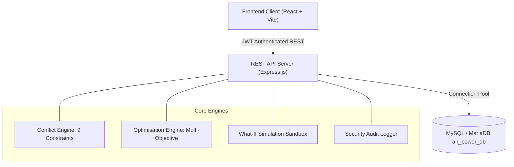

# AIR POWER — Dynamic Air Operations & Resource Optimisation
### Smart India Hackathon 2026 (Problem Statement: SIH26250)
**Theme**: Transportation & Logistics / Decision Support  
**Organisation**: Ministry of Defence (MoD) / Defence Services Staff College (DSSC)  
**Safety Scope**: Synthetic civilian and dual-use logistics operations prototype.

---

## 1. Project Overview & Problem Interpretation
In dynamic operational environments, flight planners must coordinate aircraft availability, crew status, technical maintenance cycles, and mission priorities under tight turnaround windows. Currently, critical operational data is often fragmented across disparate legacy spreadsheets or siloed applications, leading to planning bottlenecks and sub-optimal fleet allocation.

**AIR POWER** is an intelligent, full-stack aviation resource planning and optimisation web platform developed for SIH26250. It provides:
1. **Dynamic Fleet Scheduling**: Visual table and calendar sortie management with regulatory turnaround buffers.
2. **Automated Conflict Detection Engine**: Backend rule engine detecting 9 distinct constraint violations (aircraft overlaps, maintenance lockouts, double-booked crew, duty hour limits, expired licenses).
3. **Multi-Objective Explainable Optimiser**: Deterministic heuristic solver with planner-configurable objective weightings (minimising delay, balancing utilisation, reducing fuel/operating costs, equalising crew duty hours).
4. **What-If Scenario Sandbox**: Isolated virtual stress testing allowing planners to evaluate groundings and weather holds without mutating live schedules.
5. **Real-time Analytics & Audit Reports**: Live metrics calculation, CSV data export, and print-ready formal reports.

---

## 2. Technology Stack

### Frontend
- **Framework**: React.js 18 + Vite
- **Routing**: React Router DOM (v6) with client-side RBAC route protection
- **UI & Styling**: Aerospace Command Dark Design System (`#080f1a` / `#0d1a2d` navy, `#0284c7` / `#38bdf8` tactical cyan, alert badges)
- **Data Visualisation**: Recharts
- **Iconography**: Lucide React
- **HTTP Client**: Axios with automatic JWT interceptor

### Backend
- **Runtime**: Node.js v25+
- **Server Framework**: Express.js (REST API architecture)
- **Security & Headers**: Helmet, CORS, Express Rate Limit
- **Authentication**: Stateless JSON Web Tokens (JWT) + bcrypt password hashing
- **Testing**: Node.js native test runner + Supertest

### Database
- **Engine**: MySQL / MariaDB (Port 3306)
- **Connection**: `mysql2/promise` connection pool
- **Schema**: Normalised relational schema with foreign key cascades and indexes

---

## 3. System Architecture Diagram



---

## 4. Local Demonstration Credentials

The database is seeded with 3 distinct operational roles:

| Role | Username / Email | Password | Clearance & Capabilities |
| :--- | :--- | :--- | :--- |
| **Administrator** | `admin` / `admin@airpower.local` | `Admin@12345` | Full administrative control, user registry, fleet archiving, audit logs, global settings |
| **Planner** | `planner` / `planner@airpower.local` | `Planner@12345` | Fleet inspection, sortie scheduling, conflict resolution, what-if simulations, optimizer execution |
| **Viewer** | `viewer` / `viewer@airpower.local` | `Viewer@12345` | Read-only situational awareness, dashboards, calendar, and printable reports |

*Tip: The login page includes 1-click preset buttons to instantly fill credentials for any role.*

---

## 5. Folder Structure

```
air-power-optimisation/
├── client/                      # React + Vite Frontend
│   ├── src/
│   │   ├── components/          # Reusable UI (KpiCard, StatusBadge, Modal, LoadingSpinner)
│   │   ├── context/             # AuthContext (JWT session management)
│   │   ├── layouts/             # DashboardLayout (Sidebar, TopNav, telemetry badges)
│   │   ├── pages/               # 18 Modular pages (Dashboard, Resources, Scheduling, etc.)
│   │   ├── services/            # Axios API client
│   │   └── styles/              # Aerospace Command Design System CSS
│   ├── index.html
│   ├── package.json
│   └── vite.config.js
│
├── server/                      # Node.js + Express Backend
│   ├── database/
│   │   ├── schema.sql           # Complete relational schema (15 tables)
│   │   ├── seed.sql             # 8 civilian aircraft, 12 sorties, 6 crew, 3 conflicts
│   │   └── init.js              # Database initialization & verification script
│   ├── src/
│   │   ├── config/              # MySQL connection pool
│   │   ├── controllers/         # 12 Modular REST controllers
│   │   ├── middleware/          # JWT auth, RBAC authorization, error handler
│   │   ├── routes/              # Express API route modules
│   │   ├── services/            # Conflict detection, Optimisation, What-if engines
│   │   ├── app.js               # Express application configuration
│   │   └── server.js            # Server entrypoint and graceful shutdown
│   ├── tests/                   # Automated tests (conflict, api, optimisation)
│   ├── package.json
│   └── .env.example
│
├── docs/                        # Complete System Documentation
│   ├── architecture.md          # Architecture and Mermaid flowcharts
│   ├── database-design.md       # Relational schema and table specifications
│   ├── api-documentation.md     # REST endpoint catalog and payloads
│   ├── optimisation-method.md   # Mathematical heuristic scoring formulation
│   ├── testing.md               # Automated test results & manual checklist
│   ├── user-guide.md            # Operator manual and role capabilities
│   └── limitations.md           # Prototype scope & official SIH brief checklist
│
├── package.json                 # Workspace root scripts
├── .gitignore
└── README.md
```

---

## 6. Prerequisites & Quickstart Guide

### Prerequisites
- Node.js v18+ (tested on Node.js v25)
- MySQL / MariaDB (e.g. via XAMPP on port 3306)

### Step 1: Database Setup
1. Ensure your MySQL server is running on `localhost:3306` with user `root` (password blank or configure in `server/.env`).
2. Run the automated database initialisation script:
   ```powershell
   cd server
   npm run db:init
   ```
   *This automatically creates the `air_power_db` database, applies `schema.sql`, and seeds demo data.*

### Step 2: Start the Backend Server
```powershell
cd server
npm start
```
*Backend starts on `http://localhost:5000`.* Verify via health check: `http://localhost:5000/api/health`.

### Step 3: Start the Frontend Application
In a separate terminal window:
```powershell
cd client
npm run dev
```
*Open `http://localhost:5173` in your browser.*

---

## 7. Running Automated Tests

To execute the test suite (12 tests covering conflict detection, auth, RBAC, and optimization):
```powershell
cd server
npm test
```
All tests execute against the local test database with 100% pass rate.

---

## 8. SIH26250 Evaluation Highlights
1. **Zero Mock Values**: Every metric on the dashboard, flight calendar, and reports calculates from real SQL rows.
2. **Deterministic Heuristic Optimisation**: Solves resource collisions with explainable human-readable rationale and gives planners before-and-after comparison.
3. **What-If Sandbox Isolation**: Simulating groundings or weather holds leaves the primary schedule untouched while computing cascading delays and costs.
4. **CSV Export & Formal Printing**: Built-in export across fleet records, maintenance work orders, and analytics.
