# AIR POWER System Architecture — SIH26250

## 1. Executive Summary
**AIR POWER** is an intelligent, full-stack decision-support platform designed for Smart India Hackathon 2026 (SIH26250). Sponsored under the operational context of the Ministry of Defence / Defence Services Staff College (DSSC), this prototype provides dynamic resource scheduling, automated multi-constraint conflict detection, what-if operational sandboxing, and explainable heuristic flight schedule optimisation using fictional, authorised civilian aviation data.

---

## 2. Architecture Diagram

```mermaid
flowchart TB
    subgraph ClientLayer ["Frontend Client Layer (React 18 + Vite)"]
        UI["Modern Aerospace Command UI"]
        AuthCtx["JWT Auth Context & RBAC Router"]
        
        subgraph Modules ["Operational Workspaces"]
            Dash["Operations Dashboard (KPIs & Charts)"]
            Fleet["Fleet Resource Registry & CSV Export"]
            Sched["Sortie Dispatch & Visual Calendar"]
            Maint["Airframe Maintenance Registry"]
            Crew["Crew Duty & Qualifications Monitor"]
            Conf["Conflict & Constraint Centre"]
            Opt["Optimisation Engine & Heuristic Solver"]
            Sim["What-If Scenario Sandbox"]
            Rep["Analytical Audit & Print Reports"]
        end
    end

    subgraph APILayer ["Backend REST API Layer (Node.js & Express)"]
        Router["Express Modular Router"]
        Security["Helmet, CORS & Rate Limiter"]
        AuthMW["JWT Authenticator & RBAC Middleware"]
        CentralErr["Centralised Error Handler & Audit Interceptor"]
        
        subgraph CoreEngines ["Core Operational Engines"]
            ConflictEng["Constraint & Conflict Detection Engine (9 Validation Rules)"]
            OptEng["Deterministic Heuristic Optimisation Engine"]
            SimEng["Virtual Sandbox Simulation Engine (Isolated Cloning)"]
            AuditEng["Security & Event Audit Logger"]
            NotifEng["Operational Alert Dispatcher"]
        end
    end

    subgraph DataLayer ["Data Persistence Layer (MySQL / MariaDB)"]
        Pool["mysql2 Connection Pool (Port 3306)"]
        
        subgraph RelationalSchema ["Relational Schema (air_power_db)"]
            T_Users["users & roles"]
            T_Resources["resources (Aircraft Fleet)"]
            T_Activities["activities & staff_activities"]
            T_Maintenance["maintenance_records"]
            T_Staff["staff & qualifications"]
            T_Conflicts["schedule_conflicts"]
            T_Optimisation["optimisation_runs & results"]
            T_Scenarios["scenario_simulations"]
            T_Audit["audit_logs & notifications"]
            T_Settings["application_settings"]
        end
    end

    UI --> AuthCtx
    AuthCtx --> Modules
    Modules -->|Axios REST Calls| Router
    Router --> Security
    Security --> AuthMW
    AuthMW --> CoreEngines
    CoreEngines --> CentralErr
    CoreEngines --> Pool
    Pool --> RelationalSchema
```

---

## 3. Layer Breakdown

### Frontend (Client)
- **Framework**: React 18 with Vite.
- **Styling**: Aerospace Command Design System featuring dark navy (`#080f1a`, `#0d1a2d`), tactical cyan (`#0284c7`, `#38bdf8`), alert amber (`#f59e0b`), and emergency rose (`#f43f5e`).
- **Data Visualisation**: Recharts (interactive flight hours area charts, fleet category distribution bar charts).
- **Icons**: Lucide React.
- **Routing**: React Router DOM with fine-grained client-side Role-Based Access Control (RBAC).

### Backend (Server)
- **Runtime**: Node.js v25+ with Express 4.
- **Security**: Parameterised SQL queries preventing injection, Helmet security headers, rate limiting on authentication routes, bcrypt password hashing.
- **Authentication**: Stateless JSON Web Tokens (JWT) with 24-hour expiration.
- **Validation**: Strict boundary checks (duration validity, overlap detection, duty cycle limits, qualification expiration).

### Database (Data Layer)
- **Engine**: MySQL / MariaDB (via port 3306).
- **Foreign Key Constraints**: Cascading deletes for relational associations; restricted deletes for primary fleet assets and active personnel.
- **Transactions**: Atomic changes when applying recommended optimization allocations to the live schedule.
