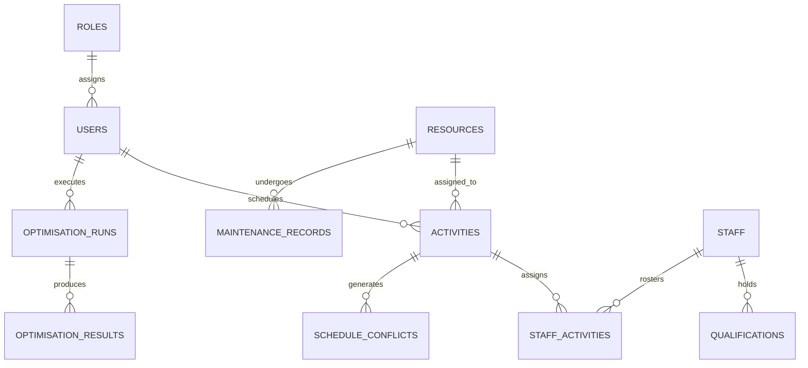

# AIR POWER Database Design — SIH26250

## 1. Schema Overview
The database `air_power_db` is a normalised relational schema designed for high-integrity scheduling, conflict tracking, and optimization.

---

## 2. Table Specifications

### `roles`
Stores authorization access levels.
- `id` (INT, PK)
- `name` (VARCHAR 50, UNIQUE) — 'Administrator', 'Planner', 'Viewer'
- `description` (VARCHAR 255)

### `users`
Operational user accounts with bcrypt hashed passwords.
- `id` (INT, PK)
- `username` (VARCHAR 60, UNIQUE)
- `email` (VARCHAR 120, UNIQUE)
- `password_hash` (VARCHAR 255)
- `role_id` (INT, FK -> roles.id)
- `full_name` (VARCHAR 100)
- `department` (VARCHAR 100)
- `is_active` (TINYINT 1)

### `resources`
Civilian and dual-use aviation assets.
- `id` (INT, PK)
- `resource_code` (VARCHAR 50, UNIQUE)
- `resource_name` (VARCHAR 100)
- `category` (ENUM: Transport Cargo, Air Ambulance, Surveillance & Recon, Multi-Role Utility, Executive Transport, Training Flight, Search & Rescue)
- `model` (VARCHAR 100)
- `registration_no` (VARCHAR 50, UNIQUE)
- `status` (ENUM: Available, Scheduled, Under Maintenance, Unavailable, Archived)
- `capacity_pax` (INT)
- `payload_capacity_kg` (DECIMAL 10,2)
- `base_location` (VARCHAR 100)
- `hourly_cost` (DECIMAL 10,2)
- `last_maintenance_date` (DATE)
- `next_scheduled_maintenance` (DATE)
- `total_flight_hours` (DECIMAL 10,2)
- `is_archived` (TINYINT 1)

### `activities`
Scheduled flight sorties.
- `id` (INT, PK)
- `activity_code` (VARCHAR 50, UNIQUE)
- `title` (VARCHAR 150)
- `category` (ENUM)
- `priority` (ENUM: Routine, High, Critical Urgent)
- `start_time` (DATETIME)
- `end_time` (DATETIME)
- `resource_id` (INT, FK -> resources.id)
- `status` (ENUM: Draft, Scheduled, In Progress, Completed, Delayed, Cancelled)
- `origin` / `destination` (VARCHAR 100)
- `estimated_duration_hours` (DECIMAL 5,2)
- `estimated_cost` (DECIMAL 10,2)
- `required_qualification` (VARCHAR 100)

### `maintenance_records`
Mandatory airframe maintenance and inspection cycles.
- `id` (INT, PK)
- `maintenance_code` (VARCHAR 50, UNIQUE)
- `resource_id` (INT, FK -> resources.id)
- `maintenance_type` (ENUM: A-Check Routine, B-Check Intermediate, C-Check Heavy Structural, Avionics Overhaul, Engine Diagnostic, Unscheduled Repair)
- `start_time` (DATETIME)
- `expected_completion` (DATETIME)
- `actual_completion` (DATETIME)
- `status` (ENUM: Scheduled, In Progress, Completed, Overdue, Cancelled)
- `assigned_technician` (VARCHAR 120)

### `schedule_conflicts`
Real-time detected schedule violations.
- `id` (INT, PK)
- `activity_id` (INT, FK -> activities.id)
- `conflict_type` (ENUM: RESOURCE_OVERLAP, MAINTENANCE_COLLISION, UNAVAILABLE_RESOURCE, STAFF_DOUBLE_BOOKED, STAFF_HOURS_VIOLATION, EXPIRED_QUALIFICATION, INVALID_DURATION, RESOURCE_CAPACITY_EXCEEDED)
- `severity` (ENUM: Warning, Critical Error, Constraint Breach)
- `description` (TEXT)
- `suggested_action` (TEXT)
- `is_resolved` (TINYINT 1)
